# 🛡️ Teaching an IoT detector to keep learning without being fooled

### The research story of Fleet-Orthogonal Adaptation (FOA)

**Group G-04: Rishit Kamboj and Farhan Naik** · CSD457 Internet of Things · Monsoon 2026
Status as of 26 November 2026

---

## ⭐ The story in 30 seconds

> An IoT device that keeps learning can be **slowly taught that attacks are normal**.
> A defence that **stops learning** when things look odd can be **frozen** by an attacker.
> We asked the neighbours: **change that other devices also see is learned freely; change only one device sees is rationed.**
> It worked in simulation on real IoT traffic. Then we built it on real boards, **found a flaw the simulations missed**, reproduced it, and designed a fix.

| 🧪 About 19,500 simulated fleet runs | 📡 9 real IoT devices + 40 weeks of real network traffic | 🔌 3 real ESP8266 boards | 📄 12-page paper |
|:---:|:---:|:---:|:---:|

---

## 🗺️ The journey

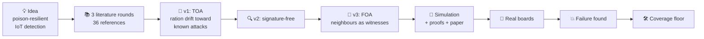

| Step | What we tried | Why we moved on |
|---|---|---|
| **v1: TOA** | Slow down only the learning that moves toward a known attack | Needs the attack signature in advance |
| **v2: signature-free** | Learn only from the dense core of normal traffic | Fails when an attack hides inside strong honest drift |
| **v3: FOA** | Use neighbouring devices as a second witness | Chosen design |

---

## 1. 😈 The problem

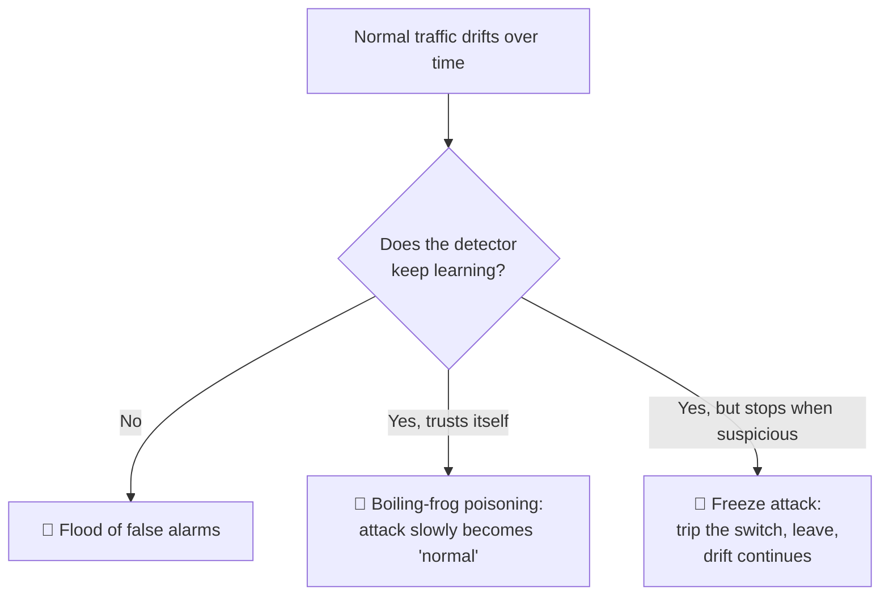

From **one** device's traffic, honest change and slow poisoning can look exactly the same.

---

## 2. 💡 The idea

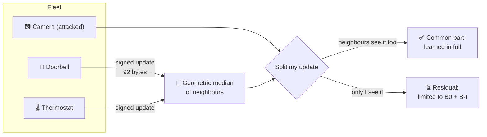

| Property | Meaning |
|---|---|
| **Never freezes** | There is no off switch for an attacker to trip |
| **Bounded** | An attacker on one device gets only a rationed amount of movement |
| **Diverse neighbours** | One exploit cannot make devices from different vendors agree |
| **Authenticated** | Forged or replayed messages are rejected (HMAC-SHA256) |

### What we proved
- **Containment:** the attacker's extra movement is at most `B0 + B·t` alarm radii, so there is a minimum time to compromise.
- **Byzantine bound:** fewer than half malicious neighbours add only a limited push per cycle.
- **Honest limit:** if only one device changes, **no method** can know whether it is honest.
- **No freeze state:** loud decoy traffic never enters learning.

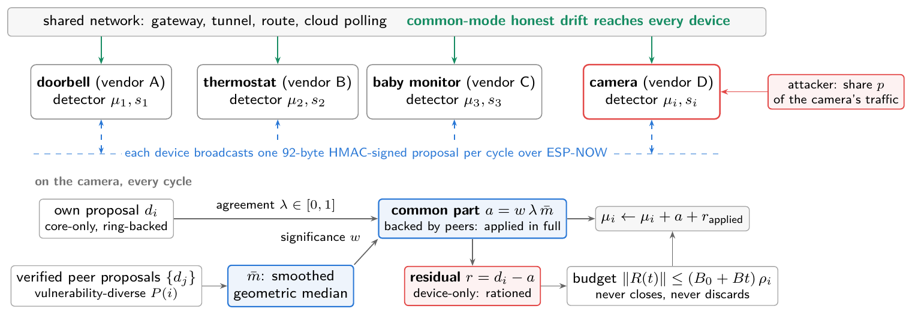

---

## 3. 🏆 Success in simulation

Real traffic from all **9 N-BaIoT devices** with real Mirai and BASHLITE attacks. Design choices were made on 2 development seeds; the results below use 10 held-out seeds.

| Test | 🥇 FOA | Others |
|---|---|---|
| False alarms after strong drift | **9.0%** | single device 24.6%, pause-learning defences 45 to 59% |
| Attack hidden inside drift (compromised) | **10.8%** | single device 39.2% |
| Classic slow poisoner | **0%** | single device up to 84% |
| Botnet infecting most cameras of one model | **0%** | same-model consensus 100% |
| Freeze attack | **unchanged** | alarm switch-off stuck at 100% false alarms |
| 40 weeks of real CESNET drift (compromised) | **0%** | single device 18% |

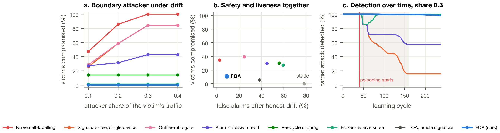

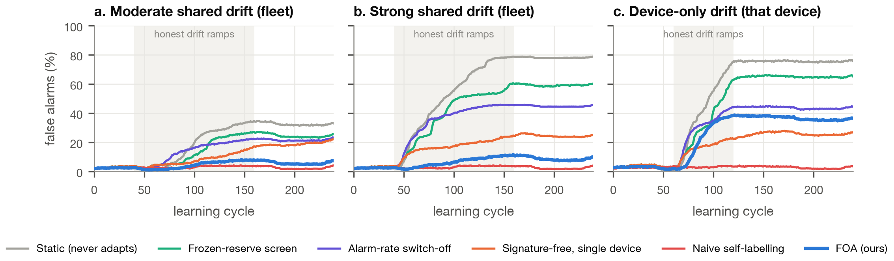

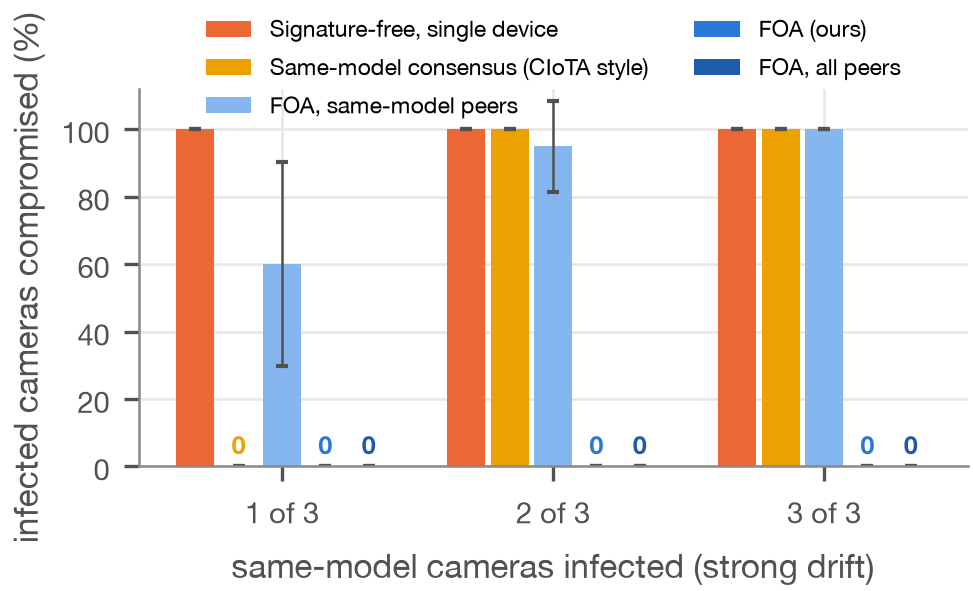

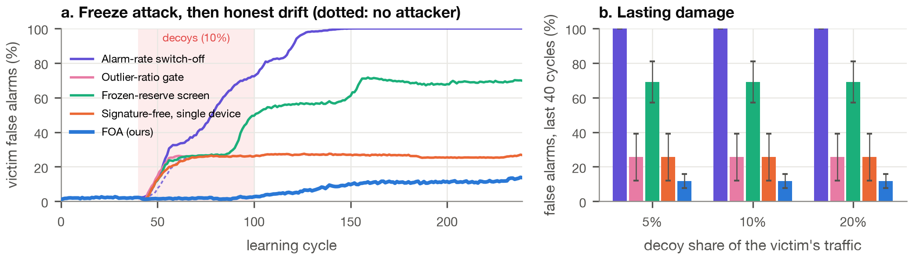

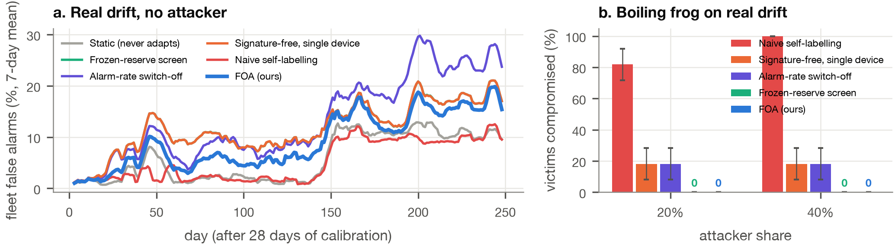

### Where it lost, even in simulation
- A device with a big change **of its own** is lost by FOA.
- Malicious neighbours **plus** a poisoner beat borderline devices (56% with 3 of 7 neighbours).
- Stealthy poisoners at 40% of traffic still win about a third of the time.

> ⚠️ The fleet's concurrency, the drift on N-BaIoT and the attacker are simulated. Section 6 revises the false-alarm comparison with a single device.

---

## 4. 🔌 Into the real world

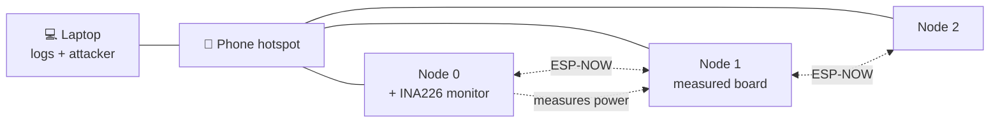

### Debugging diary: every problem we hit and fixed

| 🐞 Symptom | 🔎 Cause | ✅ Fix |
|---|---|---|
| Detector stopped learning at once | Calibrated before traffic statistics settled | 3 minute warm-up, longer calibration |
| `peers=0, rejected=1` | Boards required identical cycle numbers | Accept newer frames from each sender |
| `ina226=0` | Sensor was at address **0x44**, not 0x40 | Auto-detect the address |
| Recording stayed empty on Windows | Boot noise could crash the logger | Write logs as UTF-8 |
| Board restarted when touched | Loose power wire | Normal cable, firmer joints |

### 🥇 Hardware results

| Measure | Result |
|---|---|
| Neighbours heard (run IDLE4) | 97 to 100% of cycles |
| Update proposal / FOA step | 11.2 ms / 1.6 ms (median) |
| Sign / verify two messages | 0.6 ms / 0.95 ms |
| Message size | 92 bytes per board per cycle |
| Board power (Node 1) | **365 mW** at 5.04 V, about 2.84 J per cycle |
| Extra energy for learning | **Not detectable** with this sensor (about 7 mJ estimated from timing) |
| RAM used by firmware | about 51 of 80 KB |

---

## 5. 💥 The twist: what simulation missed

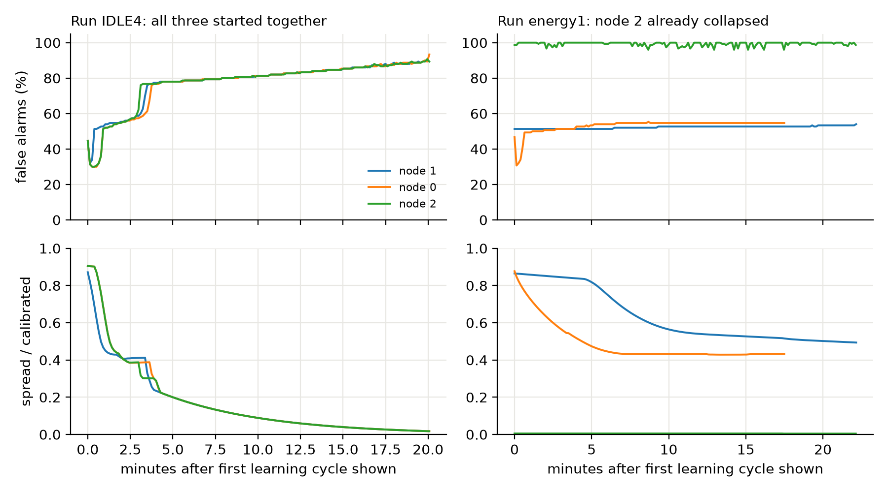

On the real boards the detector's "normal" region **shrank to under 2%**, and false alarms reached about **90%**.

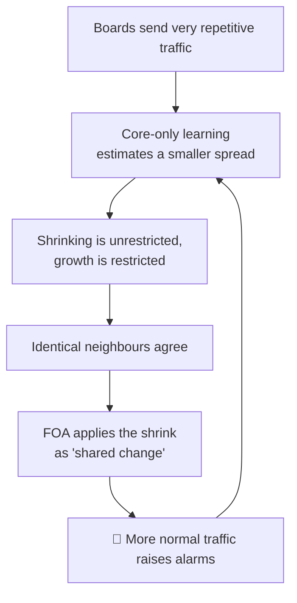

We then **reproduced it in simulation** with no attacker. This chain is our best explanation; the placeholder feature basis may also contribute.

---

## 6. 🛠️ The fix: a coverage floor

> **The normal region may never shrink below its calibrated size.** One rule, added to the update.

It only cancels shrinking, so both budgets and the containment theorem still hold. The C version matches Python exactly.

| Held-out seeds | Single device | Single device + floor | FOA | FOA + floor |
|---|:---:|:---:|:---:|:---:|
| False alarms, strong drift | 24.6% | **0.8%** | 9.0% | 2.5% |
| False alarms, device-only drift | 20.3% | **0.9%** | 28.2% | 24.6% |
| Compromised, no drift | 7.4% | 7.6% | 4.6% | **4.3%** |
| Compromised, strong drift | 39.2% | 43.1% | 10.8% | **9.4%** |
| Slow poisoner under strong drift | 63.2% | 75.4% | **0%** | **0%** |
| Repetitive traffic, false alarms | 13.7% | **1.5%** | 13.2% | **1.5%** |

### 🔬 The honest lesson
With the floor, a **single device** raises even fewer false alarms than FOA. Most of FOA's earlier false-alarm advantage came from the shrinking flaw. What **survives** is the main point: **FOA resists poisoning hidden inside drift** (9.4% against 43.1% compromised) and a one-model botnet.

⏳ **Pending:** a hardware run with the floor (`floor1`).

---

## 7. 📋 Where we stand

| Item | Status |
|---|---|
| Literature review | ✅ |
| Method and proofs | ✅ |
| Simulator, 16 tests | ✅ |
| Paper, with hardware section | ✅ |
| ESP32 and ESP8266 firmware | ✅ |
| 3-board testbed: radio, timing, power | ✅ |
| Collapse found and reproduced | ✅ |
| Coverage floor: held-out simulation | ✅ |
| Coverage floor: hardware run | ⏳ |
| Attack tests on hardware (flood, freeze, poisoning) | ❌ not yet |

---

## 8. 🎓 What this taught us

1. **Test on hardware early.** The biggest flaw appeared in the first twenty minutes on real boards.
2. **Identical devices are not independent witnesses.**
3. **A defence limited in one direction can fail in the other.** We limited growth against attackers and left shrinking free.
4. **Report what breaks.** The failure led to our next idea.

---

## 📁 Where everything lives

| What | Where |
|---|---|
| Paper | `paper/main.pdf` |
| Simulator and experiments | `experiments/foa/` |
| Hardware logs and analysis | `experiments/hardware/` |
| Firmware and build guide | `firmware/` |
| Windows kit | `windows_kit/` |
| Circuit | `circuit/` |
| Research log | `experiments/foa/RESEARCH_LOG.md` |
| References | `references.md` |
